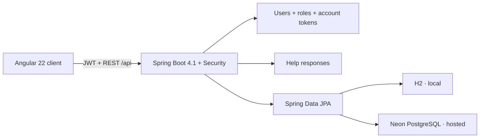

<div align="center">

# HelpHive

**A modern community help exchange built with Spring Boot, Angular, and PostgreSQL.**

[Live demo](https://helphive-community.onrender.com/) · [Features](#features) · [Run locally](#run-locally) · [API](#api) · [Deploy free](#deploy-free) · [Tech stack](#tech-stack)

</div>

## What is HelpHive?

HelpHive makes it easy for registered neighbors to request a hand or offer their time and skills. Members can browse a private community board, search by keyword or location, filter by category and status, contact one another, and follow a post from open to completed.

This is a complete full-stack project rather than a portfolio or static demo. The Angular client talks to a tested Spring Boot REST API, data is persisted with JPA, and the whole application deploys as one Docker service.

**[Open the live HelpHive application →](https://helphive-community.onrender.com/)**

## Features

- Create, read, edit, and delete community posts
- Register and sign in with a secure BCrypt-hashed account
- Members-only access to the community board and all post data
- JWT authentication with browser-session persistence
- Post ownership: only the creator can edit, delete, or change status
- Routed member workspace with My Account, My Posts, and My Responses pages
- Profile editing and secure current-password-verified password changes
- Help responses with sent/received inboxes and accept, decline, and withdraw actions
- Optional email verification with 24-hour single-use links
- Password recovery with 30-minute single-use reset links
- Admin dashboard with member roles, account suspension, activity totals, and post moderation
- Contact details visible only to signed-in community members
- Request help or offer a skill
- Keyword, category, type, and status filters
- Database-backed pagination and page-size controls for the community board
- Open → in progress → completed workflow
- Live community-impact statistics
- Responsive custom UI for desktop, tablet, and mobile
- Form validation on both client and server
- Friendly API validation and error responses
- H2 zero-configuration local database
- PostgreSQL support for hosted data
- Demo seed data on an empty database
- Spring Boot health endpoint for hosting checks
- Backend integration tests and Angular component tests
- GitHub Actions continuous integration
- Multi-stage production Docker build
- Render Blueprint for one-click infrastructure setup

## Architecture



The production Docker image builds Angular first, copies the static bundle into Spring Boot, and serves the UI and API from the same URL. That keeps the free deployment simple and avoids cross-origin configuration.

## Tech stack

| Layer | Technology |
| --- | --- |
| Frontend | Angular 22, TypeScript 6, RxJS, SCSS, reactive forms, signals |
| Backend | Java 21, Spring Boot 4.1, Spring Security, Spring Mail, Spring Web MVC, Bean Validation |
| Data | Spring Data JPA, Hibernate, H2, PostgreSQL |
| Quality | JUnit 6, MockMvc, Vitest, GitHub Actions |
| Delivery | Docker, Render Blueprint, Neon Postgres |

## Run locally

### Requirements

- Java 21
- Node.js 24+

Maven does not need to be installed; the repository includes Maven Wrapper.

### 1. Start the API

```bash
cd backend
./mvnw spring-boot:run
```

On Windows PowerShell, use `./mvnw.cmd spring-boot:run`.

The API runs at `http://localhost:8080`. H2 runs in memory and six sample posts are added automatically.

### 2. Start Angular

In a second terminal:

```bash
cd frontend
npm install
npm start
```

Open `http://localhost:4200`. The Angular development server proxies `/api` to Spring Boot.

### Run checks

```bash
cd backend
./mvnw verify

cd ../frontend
npm test -- --watch=false
npm run build
```

## API

Base path: `/api/posts`

| Method | Endpoint | Purpose |
| --- | --- | --- |
| `GET` | `/api/posts` | List and filter posts |
| `GET` | `/api/posts/{id}` | Get one post |
| `GET` | `/api/posts/mine` | Get the current member's posts |
| `GET` | `/api/posts/stats` | Get community statistics |
| `POST` | `/api/posts` | Create a post |
| `PUT` | `/api/posts/{id}` | Replace post details |
| `PATCH` | `/api/posts/{id}/status` | Change post status |
| `DELETE` | `/api/posts/{id}` | Delete a post |

Every post endpoint requires `Authorization: Bearer <token>`. Update/delete/status operations additionally require ownership. Anonymous visitors can access only registration, login, the static sign-in screen, and the hosting health check.

### Authentication

| Method | Endpoint | Purpose |
| --- | --- | --- |
| `POST` | `/api/auth/register` | Create an account |
| `POST` | `/api/auth/login` | Sign in and receive a JWT |
| `GET` | `/api/auth/me` | Read the authenticated user |
| `POST` | `/api/auth/verify-email` | Verify an email token |
| `POST` | `/api/auth/resend-verification` | Request another verification email |
| `POST` | `/api/auth/forgot-password` | Request a password-reset email |
| `POST` | `/api/auth/reset-password` | Set a password with a reset token |

### Member and response endpoints

| Method | Endpoint | Purpose |
| --- | --- | --- |
| `GET` / `PUT` | `/api/users/me` | Read or update the current profile |
| `PATCH` | `/api/users/me/password` | Change password after checking the current password |
| `POST` | `/api/posts/{id}/responses` | Respond to another member's post |
| `GET` | `/api/responses/mine` | List sent responses |
| `GET` | `/api/responses/received` | List responses received on owned posts |
| `PATCH` | `/api/responses/{id}/status` | Accept or decline a received response |
| `DELETE` | `/api/responses/{id}` | Withdraw a pending sent response |

Admin endpoints live under `/api/admin/**` and require the `ADMIN` role.

Registration does not grant immediate community access: after creating an account, the user signs in to receive a JWT. Passwords are never stored directly; Spring Security hashes them with BCrypt. JWTs expire after two hours by default and the Angular client keeps the token in `sessionStorage`, so closing the browser session signs the user out.

When email delivery is enabled, new accounts must verify their email before signing in. Existing accounts remain verified during the database upgrade.

List filters are optional query parameters: `search`, `category`, `type`, and `status`.
Pagination query parameters are `page` (zero-based, defaults to `0`) and `size` (defaults to `9`, maximum `50`). The response contains `content`, `page`, `size`, `totalElements`, `totalPages`, `first`, and `last`.

Example:

```http
GET /api/posts?search=laptop&category=TECHNOLOGY&status=OPEN&page=0&size=9
```

Health check: `GET /actuator/health`

## Deploy free

The easiest setup uses one free Render web service and one free Neon PostgreSQL database. The included `render.yaml` and `Dockerfile` do the full Angular + Java build.

### 1. Put the project on GitHub

Create an empty public repository, then run from this folder:

```bash
git remote add origin https://github.com/YOUR_USERNAME/helphive.git
git branch -M main
git push -u origin main
```

### 2. Create the free database

1. Create a free project at [Neon](https://neon.com/).
2. Open **Connect** and keep the host, database, username, and password.
3. Convert the connection to this JDBC form:

```text
jdbc:postgresql://YOUR_NEON_HOST/YOUR_DATABASE?sslmode=require
```

### 3. Deploy on Render

1. Sign in to [Render](https://render.com/) with GitHub.
2. Choose **New → Blueprint**.
3. Select the HelpHive repository. Render detects `render.yaml`.
4. Choose the **Free** instance and enter the prompted variables:

| Variable | Value |
| --- | --- |
| `DATABASE_URL` | The JDBC URL from step 2 |
| `DATABASE_USERNAME` | Your Neon role/user |
| `DATABASE_PASSWORD` | Your Neon password |

5. Apply the Blueprint and wait for the first Docker build.

`ADMIN_EMAILS` is set in `render.yaml` to the project owner's email. Any listed address is promoted to admin the next time that account signs in. Use a comma-separated list to add more trusted administrators.

### Optional email delivery

The deployed app keeps `MAIL_ENABLED=false` initially so current registration continues working before an SMTP provider is connected. To require email verification and send reset links, add these Render environment variables and redeploy:

| Variable | Example |
| --- | --- |
| `MAIL_ENABLED` | `true` |
| `MAIL_FROM` | `no-reply@your-domain.com` |
| `SPRING_MAIL_HOST` | SMTP host supplied by your mail provider |
| `SPRING_MAIL_PORT` | `587` |
| `SPRING_MAIL_USERNAME` | SMTP username |
| `SPRING_MAIL_PASSWORD` | SMTP password/secret |
| `SPRING_MAIL_PROPERTIES_MAIL_SMTP_AUTH` | `true` |
| `SPRING_MAIL_PROPERTIES_MAIL_SMTP_STARTTLS_ENABLE` | `true` |

`PUBLIC_URL` is already set to the live HelpHive URL and is used to create verification and reset links. Never commit SMTP credentials.

Render automatically generates a private `JWT_SECRET` from `render.yaml`. For any non-Render production deployment, set `JWT_SECRET` to a cryptographically random value of at least 32 characters. You can optionally set `JWT_EXPIRATION` as an ISO-8601 duration such as `PT2H`.

Render gives the app a free `https://...onrender.com` URL and automatically redeploys after pushes to `main`. Free Render services sleep after inactivity, so the first request after a quiet period can take about a minute. The database remains external in Neon, so data is not lost when the service sleeps or redeploys.

> Never commit a real database password. The Blueprint marks all database values as secrets and asks for them in Render.

Existing seeded demo posts have no owner and remain read-only. New posts are linked to the account that creates them.

## Project structure

```text
helphive/
├── .github/workflows/ci.yml    # build and test on every push/PR
├── backend/                    # Spring Boot REST API
│   ├── src/main/java/          # controller, service, repository, entities
│   ├── src/main/resources/     # local/hosted configuration
│   └── src/test/               # MockMvc integration tests
├── frontend/                   # Angular single-page application
│   └── src/app/                # UI, model, and API service
├── Dockerfile                  # production multi-stage build
└── render.yaml                 # free-hosting Blueprint
```

## Ideas for the next version

- Refresh-token rotation using secure HttpOnly cookies
- Member reporting workflows and admin audit history
- Image uploads with object storage
- Map-based distance filtering
- Email notifications

## License

Released under the [MIT License](LICENSE).
